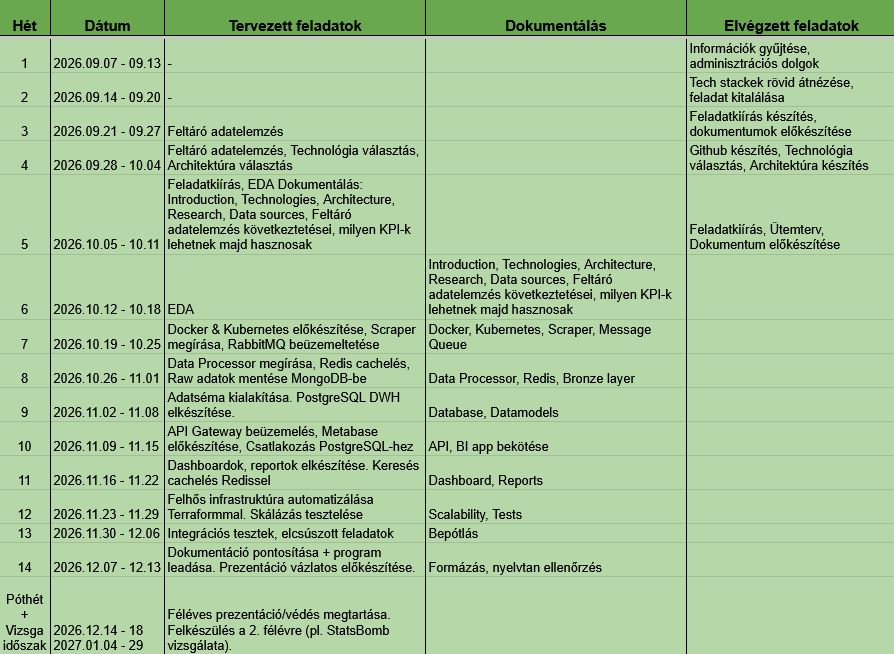

# Development of a football analytics BI system based on spatial match events and market indicators

Repository for my thesis work.

- Link to the study paper that inspired my project: https://www.nature.com/articles/s41597-019-0247-7#Tab1
- Link to the documentation: https://bmeedu-my.sharepoint.com/:w:/g/personal/dszabo_1_edu_bme_hu/cQqp5mBkHEnqSY4bVPod_sg6EgUCPnM9V4k_QaJndKrhZLFcfQ

Weekly plan & completed tasks:



## Data Sources

### Scrapers

- Transfermarkt: https://github.com/felipeall/transfermarkt-api
- Capology: Own Implementation

### Datasets

- Wyscout: https://github.com/koenvo/wyscout-soccer-match-event-dataset

### Potential additions:

- Capology: https://apify.com/jungle_synthesizer/capology-football-player-salary-scraper
- StatsBomb Open Data: https://github.com/hudl/open-data

- Transfermarkt Datasets
    - https://github.com/salimt/football-datasets
    - https://www.kaggle.com/datasets/davidcariboo/player-scores
    - https://github.com/dcaribou/transfermarkt-datasets

## Scraper-service

The data integration pipeline uses Docker to scrape, structure, and queue the football data asynchronously.

### 1. Setup Environment

Ensure you have a `.env` file in the repository root containing your database credentials ( `MONGO_USER`, `MONGO_PASSWORD`, `RABBITMQ_USER`, `RABBITMQ_PASSWORD`).

### 2. Start Backend Infrastructure

Boot up the local API, MongoDB, and RabbitMQ in the background:
```bash
docker compose up -d transfermarkt-api mongodb rabbitmq
```
*Wait a few seconds and ensure they are running using `docker compose ps`.*

### 3. Execute the Scraper

Build and run the ingestion pipeline. This will download Wyscout events, scrape Capology & Transfermarkt, and queue the Claim-Check messages:
```bash
docker compose up --build scraper-pipeline
```

### 4. Verification

Once you see `[PIPELINE COMPLETE]` and the container exits with code `0`, verify the data ingestion was successful:
* **RabbitMQ:** Open `http://localhost:15672` and check `data_processing_queue`.
* **MongoDB:** Replace `MONGO_USER` and `MONGO_PASSWORD` in the following command with your own, and run the command to check the document count:
  ```bash
  docker exec raw-db-mongodb mongosh --quiet \
    --username 'MONGO_USER' \
    --password 'MONGO_PASSWORD' \
    --authenticationDatabase admin \
    --eval "db.getSiblingDB('football_raw_db').raw_payloads.countDocuments()"
  ```

  In PowerShell, use the backtick (`) as the line-continuation character:

  ```powershell
  docker exec raw-db-mongodb mongosh --quiet `
    --username 'MONGO_USER' `
    --password 'MONGO_PASSWORD' `
    --authenticationDatabase admin `
    --eval "db.getSiblingDB('football_raw_db').raw_payloads.countDocuments()"
  ```
*Both systems should report exactly **5,386** payloads/messages ready for the downstream `.NET` worker.*