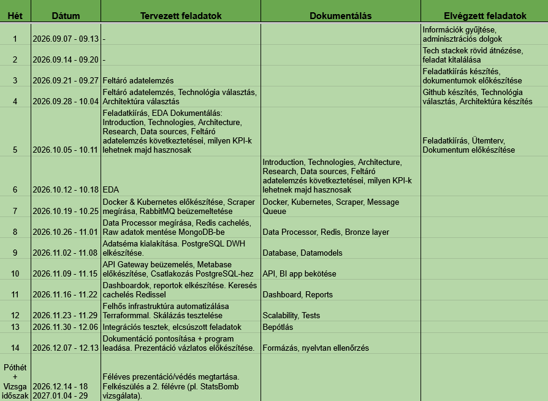

# Development of a football analytics BI system based on spatial match events and market indicators

Repository for my thesis work.

- Link to the study paper that inspired my project: https://www.nature.com/articles/s41597-019-0247-7#Tab1
- Link to the documentation: https://bmeedu-my.sharepoint.com/:w:/g/personal/dszabo_1_edu_bme_hu/cQqp5mBkHEnqSY4bVPod_sg6EgUCPnM9V4k_QaJndKrhZLFcfQ

Weekly plan & completed tasks:

## Data Sources

### Scrapers

- Transfermarkt: https://github.com/felipeall/transfermarkt-api
- Capology: https://apify.com/jungle_synthesizer/capology-football-player-salary-scraper

### Datasets

- Wyscout: https://github.com/koenvo/wyscout-soccer-match-event-dataset
- StatsBomb Open Data: https://github.com/hudl/open-data

- Transfermarkt Datasets
    - https://github.com/salimt/football-datasets
    - https://www.kaggle.com/datasets/davidcariboo/player-scores
    - https://github.com/dcaribou/transfermarkt-datasets